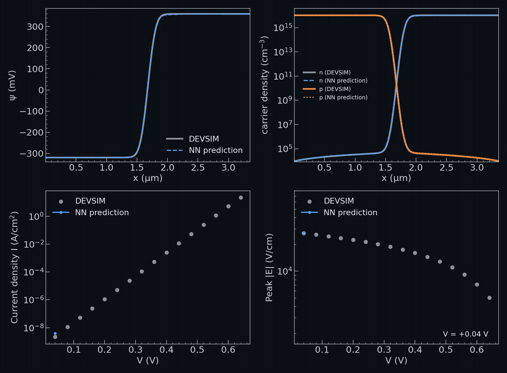

# QFL physics-informed surrogate for p-n diodes

Code accompanying the paper (`main_v10.tex`): a physics-informed neural network (PINN) for the p-n diode drift-diffusion problem, written in
quasi-Fermi-level (QFL) space and conditioned on the device parameters with FiLM layers. One network covers a whole family of devices
(1D symmetric doping, 1D asymmetric doping, and a 2D planar benchmark) and is trained against DEVSIM simulations plus the drift-diffusion residuals.
The network outputs the electrostatic potential and the two quasi-Fermi levels; every quantity of interest (current, depletion width, peak field,
stored charge, ...) is read from that state, together with a calibrated 90% error bar for the deployed readouts.

**Illustration of the results:** 

shows the network's prediction for an unseen device (idx 31) swept over voltage: state profiles, current-voltage curve and peak field.

## Status of the release

**Not yet available** (they will be released via Zenodo in the near future):

- **the network checkpoints** (trained models), and
- **the training anchors**: the DEVSIM `.npz` files the anchor lists in `data/anchor_lists/` point to (1D grids, asymmetric devices, 2D planar solutions).

This repository therefore contains the code, the anchor lists (file names only), the result tables and arrays behind the paper figures, and the tests.
Until the data are released, training and evaluation need your own DEVSIM data: the scripts in `devsim_data_generator/` generate the 1D grids,
the asymmetric devices and the planar 2D diode (DEVSIM is required for that step only). All paper figures can be regenerated from `paper_data/` without
checkpoints or DEVSIM data (see below).

## The recipe

This release contains only the recipe used for the paper's production results (the six-seed 1D runs and the asymmetric and 2D benchmarks).
It has no option switches; the recipe is fixed in `src/config.py`:

| Setting | Value |
|---|---|
| Contact trim | 1 raw DEVSIM node (1 nm) per contact; 1 nm contact inset for the 2D devices |
| Epochs / optimiser | 20000, Adam 1e-3, StepLR (step 7000, gamma 0.1), minibatch of 64 anchors |
| Voltage centring | fixed `V_c = 12.361324787139893` (V/Ut) |
| Conditioning | 6 FiLM columns (no eta column); 2D adds 4 geometry columns |
| Continuity loss | pointwise residual times `J_ref * ell` (no SRH-peak divisor) |
| Boundary pins | DEVSIM's own node values at the window edge (no symmetric pinning) |
| Reference doping | `n_max = max(nA, nD)` |
| Network | TripleNet, 4 x 128 Tanh, 128-wide phi-net, unbounded FiLM gamma, v_p recentred |

The seed is the only environment option: `QFL_SEED` (default 0).

## Running

Requirements: Python 3 with PyTorch, NumPy, SciPy, pandas and matplotlib (DEVSIM only to generate data).

Train and evaluate (1D; needs the anchor `.npz` files listed in the anchor lists):

```
python -m src.run_train_eval_qfl_film --train-list data/anchor_lists/qfl_pe_dh3_train_vbi08.txt \
    --holdout-list data/anchor_lists/qfl_pe_dh3_holdout.txt --out-dir results/run0
QFL_SEED=1 python -m src.run_train_eval_qfl_film ...        # another seed
python -m src.run_train_eval_qfl_2d --train-list <train.txt> [--holdout-list <holdout.txt>] --out-dir results/run2d
```

`qfl_pe_dh3_train_vbi08.txt` is the 404-anchor training list of the paper (V/V_bi >= 0.8 removed). Each run writes `loss_curves.png`, `eval_summary.csv`
(per-anchor quantity-of-interest suite) and per-anchor plots. A checkpoint loads only into `build_model(v_centre)` from `run_train_eval_qfl_film.py`;
the runs save `v_centre.json` next to it.

Tests (no data needed beyond `handoff_data/`): `python -m pytest tests -q`.

## Reproducing the paper figures

`paper_data/` holds everything the figures are plotted from: result tables (`six_seed/`, `data_only/`, `control/`, `uq/`, the extrapolation pilot) and the
arrays behind the network-based figures (`figure_data/`: network and DEVSIM profiles, evaluated once). `paper_figs/` has one plain script per figure
(`fig_*.py`, shared setup in `common.py`) and the notebook `paper_figs/paper_figures.ipynb`, which runs them all and shows the result. Each script also runs
on its own (`cd paper_figs && python fig_iv_overlay.py`) and writes PNG and PDF to `paper_figs/output/`. No network, checkpoint or DEVSIM data is needed.
All 14 figures of the paper are covered. `paper_figs/export/` holds the dev-only scripts that produced `figure_data/` from trained checkpoints (they need
the checkpoints and DEVSIM data, and for one figure the development repository).

## Deployment check

`src/uq.py: query_status(L, nD, V, bar_json, eqi)` returns the 90% bar of a query only if it is inside the trained box
(L in [1e-5, 7e-4] cm, nD in [1e15, 1e19] cm^-3, V in [0.04, 0.64] V), has V/V_bi < 0.8, and `log10(W_dep/L)` is inside the
calibrated support of the quantity; otherwise it returns the reason and no bar. The bar is `paper_data/uq/calibration_bar.json`.

## Layout

- `src/` - model, losses, training, evaluation (`run_train_eval_qfl_film.py` for 1D, `run_train_eval_qfl_2d.py` for 2D,
  `evaluate.py` / `evaluate2d.py` / `qoi2d.py` / `readout2d.py` for the quantities of interest, `uq.py` for the deployment check).
- `devsim_data_generator/` - DEVSIM scripts that produce the 1D grids, the asymmetric devices and the planar 2D diode.
- `scripts/` - 2D data conversion (`planar2d_to_anchors.py`), 2D QoI table (`eval_planar2d_qoi.py`), re-evaluation of a trained run (`reeval_film.py`),
  asymmetric state figure (`make_paper_asym_figs.py`), asymmetric data check.
- `data/anchor_lists/` - anchor lists (plain text, one `.npz` path per line): production split (`qfl_pe_dh3_*`) and asymmetric benchmark (`showcase_asym_*`).
- `paper_data/`, `paper_figs/` - figure inputs and figure scripts (above).
- `handoff_data/` - three anchors used by the tests. `tests/` - unit tests.

The development repository also contains the older non-FiLM pipeline and the switches for the ablations (eta column, SRH divisor, symmetric pins, trim width),
which are not part of this release.
